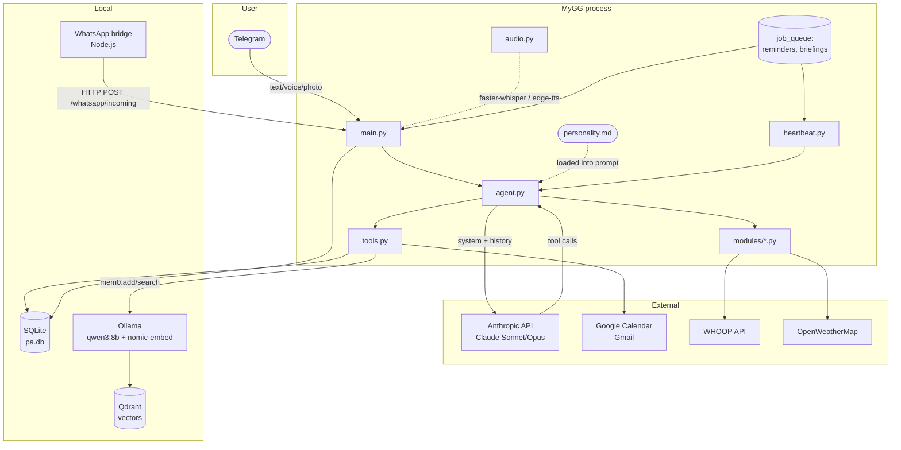

# Architecture

This document is a technical overview of MyGG — the components, how they
interact, and the conventions that hold it together. Read this before
contributing or before forking.

## High-level diagram



## Components

### `main.py` — Telegram I/O and lifecycle

The entry point. Loads `.env`, builds the `python-telegram-bot`
`Application`, registers handlers for text, voice, photo, document, and
location messages, and schedules recurring jobs (reminder polling,
heartbeats, WhatsApp summarization).

Key responsibilities:

- Per-message authorization via `ALLOWED_USER_IDS`.
- Routing each Telegram message type to the right handler:
  - text → `agent.handle_message`
  - voice/audio → `tools.transcribe_audio` → `agent.handle_message`,
    or `modules.meetings._handle_process_meeting` if longer than
    `VOICE_LONG_THRESHOLD_SECONDS`
  - photo → multimodal content blocks (vision) → `agent.handle_message`
  - document (image / PDF / audio / text) → respective sub-handler
- Splitting long replies into Telegram-sized chunks (`utils.split_long_message`).
- Sending typing indicators while Claude thinks.
- Initializing SQLite (via `tools.init_db`) and pre-loading Whisper.

### `agent.py` — Claude tool-use loop

Wraps the Anthropic SDK in an agent loop. Maintains per-chat conversation
history (bounded; oldest evicted when over 50 conversations). Every
incoming message:

1. Auto-recalls relevant memories (`tools.recall(user_text)`, with timeout).
2. Builds the system prompt:
   - Time-of-day greeting guidance.
   - Personality (verbatim from `personality.md` if present).
   - Behavior rules (proactive memory, context awareness, etc.).
   - Active modules.
   - Communication rules.
   - Recalled memories (if any).
3. Calls Claude with the full tool catalogue (core + module-contributed).
4. Iterates: if Claude returns `tool_use` blocks, dispatches them via
   `_execute_tool` (core) or `modules.execute_tool` (module-owned), and
   feeds the results back. Loops up to 25 iterations.
5. Returns the final text and any audio side-channel files.

The loop also handles Anthropic's server-side tools (`web_search`,
`web_fetch`, `code_execution`) transparently — the SDK pauses with
`stop_reason="pause_turn"` and we just call the API again.

Concurrency: each chat ID has its own `asyncio.Lock`. Heartbeats and user
messages contend for the same lock so you never see interleaved tool
calls in a single conversation.

### `tools.py` — core tool implementations

Implements every tool whose name lives in `agent.TOOL_DEFINITIONS`. Owns:

- **Memory** — `remember()` / `recall()` via mem0 backed by Qdrant +
  Ollama. mem0 is initialized lazily in a thread-safe singleton.
- **Google Calendar / Gmail** — `get_calendar`, `create_event`,
  `list_emails`, `read_email`, `send_email`, `reply_email`.
  Multi-account support via `GOOGLE_ACCOUNTS` dict; each account has its
  own `token.json` and is auto-refreshed when expired.
- **Todos** — SQLite-backed `add_todo`, `list_todos`, `complete_todo`,
  `delete_todo`.
- **Reminders** — SQLite-backed `set_reminder`, polled every 60s by
  `check_reminders` in `main.py`.
- **WhatsApp search** — `search_whatsapp`, `get_whatsapp_summary` (read
  from the SQLite mirror that the Node bridge populates).
- **Audio** — thin wrappers around `audio.transcriber` and
  `audio.synthesizer`.

### `modules/` — pluggable capability modules

Auto-discovered at startup by `modules/__init__.py:discover()`. Each
module is a single `.py` file that exports:

- `TOOL_DEFINITIONS: list[dict]` — Anthropic tool schemas.
- `async execute_tool(name, input_data)` — dispatcher.
- `async heartbeat_contributions()` — *optional*, returns a one-line
  summary for morning/evening briefings or None.

Files starting with `_` (e.g. `_template.py`) are skipped. Module tools
share the same flat namespace as core tools — collisions are logged.

The shipped modules are:

- `weather.py` — OpenWeatherMap current conditions, with a remembered
  "current location" (`.current_location` JSON file).
- `whoop.py` — full WHOOP developer-API integration (recovery, sleep,
  strain, workouts, profile) with auto-refreshing OAuth tokens.
- `meetings.py` — meeting transcription pipeline: `process_meeting` →
  Whisper → Claude (for structured extraction) → SQLite
  (`meeting_notes` table) → todos created from action items →
  optional `meeting_clarify` round-trip.

Use `modules/_template.py` as a starting point for new modules.

### `heartbeat.py` — proactive briefings

Three jobs registered with the bot's `job_queue`:

- **morning_briefing** — runs daily at 07:30 (`TIMEZONE`-aware). Sends a
  synthetic prompt through the agent loop asking for a briefing —
  calendar, todos, emails, WhatsApp highlights, weather, recalled
  memories, and module contributions.
- **evening_wrapup** — runs daily at 21:00. Recap of today and preview
  of tomorrow.
- **check_upcoming_meetings** — runs every 5 minutes. Fetches events
  starting in the next 20 minutes; alerts on each event 0–15 minutes
  out, deduplicating with a per-day `_alerted_events` set.

Heartbeats deliberately route through `agent.handle_message` so the
assistant uses its real tools — there's no separate code path that
hand-rolls a briefing.

### `audio.py` — speech I/O

Two singletons: `transcriber` (faster-whisper, GPU if available) and
`synthesizer` (Edge TTS). Whisper is pre-loaded at startup to avoid CUDA
loading mid-conversation, which has been known to crash Python.

### `whatsapp-bridge/` — Node.js sidecar (optional)

A minimal Baileys-based WhatsApp client. Listens for incoming messages
and POSTs them to `http://127.0.0.1:8787/whatsapp/incoming` (the receiver
is `whatsapp_server.py`). Authentication uses a shared bearer token
(`WHATSAPP_BRIDGE_SECRET`).

The bridge is intentionally read-only — it does not send messages.

### `whatsapp_summarizer.py`

Runs every 30 minutes via `job_queue`. Picks up unsummarized WhatsApp
messages, groups them by chat, asks Claude for an actionable summary
("commitments, meetings, decisions, anything to act on"), and stores
the summary in mem0 with `whatsapp` tags. After processing, marks the
batch `summarized=1` in SQLite so it isn't re-summarized.

## Data flow — incoming text message

```
Telegram                main.py                agent.py           Claude          tools.py / modules
   │                       │                      │                  │                    │
   │── "what's on today" ─►│                      │                  │                    │
   │                       │─ handle_text ───────►│                  │                    │
   │                       │   (auth, typing)     │                  │                    │
   │                       │                      │─ recall(query) ──┼───────────────────►│
   │                       │                      │◄──── memories ───┼────────────────────│
   │                       │                      │                  │                    │
   │                       │                      │── system+history+tools ──►│           │
   │                       │                      │                  │                    │
   │                       │                      │◄── tool_use(get_calendar) ┤           │
   │                       │                      │─ get_calendar ───┼───────────────────►│
   │                       │                      │◄──── events ─────┼────────────────────│
   │                       │                      │── tool_result ───►│                   │
   │                       │                      │◄──── final text ──┤                   │
   │                       │◄─ (text, audio[]) ───┤                  │                    │
   │◄──── reply ───────────┤                      │                  │                    │
```

## Storage

| Store          | What's in it                                              | Lifecycle                        |
| -------------- | --------------------------------------------------------- | -------------------------------- |
| `pa.db` (SQLite) | todos, reminders, whatsapp_messages, meeting_notes      | Created on first run.            |
| Qdrant         | Vector embeddings of memories (mem0).                     | Persists in `qdrant_storage/`.   |
| `token.json`   | Google OAuth tokens (per account).                        | Refreshed in place when expired. |
| `.whoop_token.json` | WHOOP OAuth tokens.                                  | Refreshed by `modules/whoop.py`. |
| `.current_location` | Last-known location (city + lat/lon).                | Updated by `update_location_from_gps` and `get_weather`. |
| `meeting_transcripts/` | Full transcripts (one file per meeting).          | Reference data for clarifications. |

## Concurrency and bounds

- **Per-chat lock** (`asyncio.Lock`) — prevents interleaving between user
  messages, heartbeats, and reminder pings on the same chat.
- **History trim** (`MAX_HISTORY=80`) — applied after every turn at
  user-message boundaries to avoid orphaned `tool_use`/`tool_result`
  pairs that would 400 the API.
- **Conversation eviction** (`MAX_CONVERSATIONS=50`) — drops the oldest
  chat history (and its lock, model override, last-user-message)
  whenever over the cap.
- **Lock-acquire timeout** (`LOCK_ACQUIRE_TIMEOUT_SECONDS=120`) — replies
  "I'm still working on something — give me a moment" instead of queueing
  forever.
- **Tool-result truncation** (`TOOL_RESULT_MAX_CHARS=6000`) — caps any
  single tool result so it can't drown out earlier turns.
- **Memory recall timeout** (`MEMORY_RECALL_TIMEOUT_SECONDS=15`) — mem0
  is allowed 15s before we proceed without context.
- **Tool-loop max iterations** = 25 — guards against runaway tool loops.

These constants live in `constants.py`.

## Memory model

mem0 is configured with:

- LLM: Ollama `qwen3:8b` (decides what's worth remembering, deduplicates).
- Embedder: Ollama `nomic-embed-text` (768-dim).
- Vector store: Qdrant collection `mygg_memories`.
- `user_id`: the lowercased value of `USER_NAME` (so memories are
  namespaced — useful if multiple instances share a Qdrant).

`remember(text, tags)` adds to the store with a `stored_at` timestamp.
`recall(query)` does semantic top-k=10 retrieval. The agent loop also
auto-recalls on every turn before calling Claude, so relevant context
is always available without the user asking for it.

## Self-modification — not included

The original GG (the project this template was extracted from) had a
`evolve` tool that allowed Claude to modify its own source by shelling
out to Claude Code. That feature is **not** part of MyGG: it requires
careful safeword gating, validation, and rollback machinery that we
deliberately keep out of the public template. Adding it back is left as
an exercise; see the changelog of the parent project for prior art.
