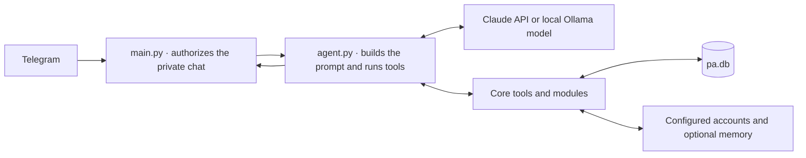

# How MyGG works

## A turn in Telegram

1. `main.py` receives an update through Telegram polling. It checks the chat type and sender, then routes the message or uploaded file. Short voice notes go through Whisper. Longer recordings and audio documents enter the meetings workflow.
2. `agent.py` combines the message with bounded per-chat history, the optional personality file, and relevant memories if enabled. A per-chat lock serializes turns. The selected backend returns a response or requests a tool.
3. The agent dispatches tool calls to `tools.py` or a discovered module and feeds results back to the model. In Claude mode the provider also offers hosted tools. Local mode uses Ollama for chat, briefings, meeting analysis and WhatsApp summarization. Unsupported cloud-only capabilities are disabled.
4. `main.py` sends the result to the authorized Telegram chat. Sending Gmail or WhatsApp text, or creating an event with guests, requires a separate confirmation in that chat. Details and expiry are in the [setup guide](ONBOARDING.md#google-calendar-and-gmail).

## Components

| Component | Responsibilities |
| --- | --- |
| `main.py`, `heartbeat.py` | Telegram handlers, attachment routing, reminders, scheduled briefings and meeting alerts. |
| `agent.py`, `llm.py` | Per-chat state, model selection, prompt construction and tool-use loop. |
| `tools.py` | SQLite storage, Gmail, Calendar, to-dos, reminders, optional memory and WhatsApp queries. |
| `modules/__init__.py` | Discovers modules at startup and routes their declared tools. A module exports `TOOL_DEFINITIONS` and an asynchronous `execute_tool`. It may also export `heartbeat_contributions`. See [the module template](modules/_template.py). |
| `modules/meetings.py`, `audio.py` | Local transcription, meeting notes, action items and optional Edge TTS. |
| `modules/weather.py`, `modules/whoop.py` | Location-based weather and WHOOP metrics, with context for briefings. |
| `whatsapp-bridge/`, `whatsapp_server.py`, `whatsapp_summarizer.py` | A linked WhatsApp client forwards new messages to a secret-protected loopback receiver. Queries read the local message table. A scheduled job can summarize messages into long-term memory. |
| `setup_calendar.py`, `whoop_auth.py` | Interactive authorization on the local machine. The resulting tokens grant the runtime access to the account. |
| `modules/tasks.py`, `modules/goals.py`, `modules/feedback.py`, `modules/protagonism.py` | Editable tasks, goal history, item-level feedback, portfolio and knowledge lookup, initiative, and contextual follow-ups. |
| `modules/_web.py`, `modules/_documents.py`, `modules/_outgoing.py` | Local web research, searchable PDF text, confirmed delivery and receipts. |
| `connection_health.py`, `supervise.py` | Service checks and optional warm-up, owned-process restart and checked Git updates. See [operations](OPERATIONS.md). |
| `evolve.py` | Handles direct owner code-change requests through Claude Code in a disposable checkout. |

## What persists

| Data | Where it lives |
| --- | --- |
| Recent conversations, outstanding approvals and delivery receipts | SQLite in `pa.db`. The chat history is bounded and excludes raw attachment bytes and hidden reasoning. Model overrides are session state. |
| To-dos, goals, feedback, reminders, meeting records and captured WhatsApp messages | SQLite in `pa.db`. With the Google task backend, tasks live in Google Tasks. |
| Full meeting transcripts | Text files under `meeting_transcripts/`. |
| Optional long-term memory | mem0 uses Ollama for extraction/embedding and Qdrant for vector storage. Preserve the collection name, volume and user identifier on upgrades. |
| Personalized instructions and most recent weather location | `personality.md` and `.current_location`. |
| Provider credentials and sessions | `.env`, Google and WHOOP token files, and `whatsapp-bridge/auth_state/`. See [security notes](SECURITY.md). |

The repository carries example configuration and personality files. Each installation supplies its own accounts and data. The [installation guide](ONBOARDING.md) lists setup and verification steps for each component.
